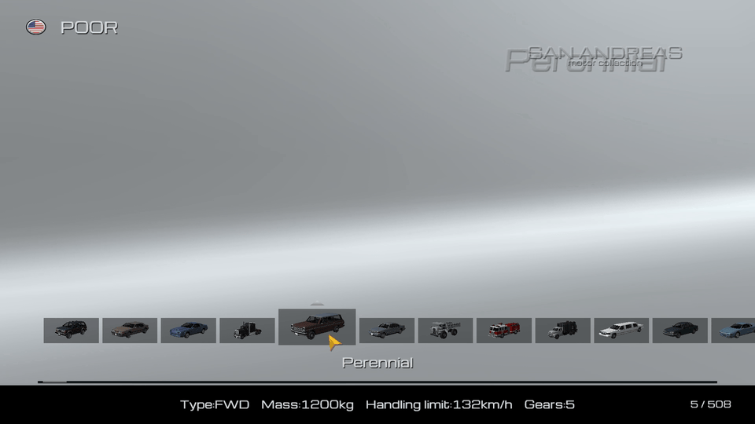

# GT4 Showroom

Gran Turismo 4 inspired vehicle showroom and spawner for classic GTA San Andreas.

## Features

- Animated 3D showroom with installed and add-on vehicles, full paint names and native livery texture previews.
- Persistent Favorites, country filtering, and name, class, top speed or model ID sorting from the right-click sidebar.
- Cinematic view with free orbit, zoom and optional automatic rotation.
- Model name/ID search, configurable exclusions and country badges.
- Keyboard, mouse and controller navigation, including an on-screen search keyboard.

## Install

Requires **classic GTA San Andreas PC 1.0 US Hoodlum/Compact, 32-bit**, Windows, DirectX 9 and a working **32-bit ASI loader**. Mod Loader is recommended. Other executable editions, mobile and Definitive Edition are unsupported.

Close GTA. Copy the contents of `install` into one Mod Loader folder, such as `modloader/GT4 Showroom`. Keep `GT4Showroom.asi`, `GT4Showroom.ini` and the `GT4Showroom` asset folder together. With a loader that scans the game root, the same three items can be placed together there instead.

When updating, replace the ASI and retain your customized INI, `vehicles.ini`, assets and personal `favorites.ini`. The update ZIP includes an example INI to merge. Disable the mod folder while GTA is closed to uninstall.

## Controls

| Input | Action |
| --- | --- |
| F1 | Open/close; configurable in the INI, on foot outside cutscenes |
| Left/Right or mouse wheel | Browse vehicles, colors or liveries |
| Enter / Space | Vehicle → color → livery when available → spawn |
| Backspace | Return one selection step; exit from the vehicle list |
| Right mouse / Menu key | Open the sorting, country, Favorites and Cinematic sidebar |
| Up / Down | Add / remove the selected favorite |
| F | Toggle Favorites / All Cars |
| Backtick | Search an ID or internal/display model name |
| Escape | Native pause |
| GTSPAWN | Type outside search to reload settings |

Click selection rectangles or drag the lower browse bar. The cursor returns to the selected rectangle only after keyboard, wheel or controller browsing changes the selection. It stays where you leave it while idle.

In Cinematic, Space or clicking the car toggles rotation; drag the car to orbit and use the wheel to zoom. Backspace returns. Enter `ENTHUSIA`, `GT4` or `REALBIG` in model search for the alternate preview, normal preview or configured bonus vehicle.

Controller: View/Select opens the showroom/sidebar; D-pad/left stick navigates; A confirms; B returns; X adds Favorites; Y opens Favorites; D-pad Down removes; left-stick click opens search. Right stick orbits and triggers zoom in Cinematic. Start pauses.
